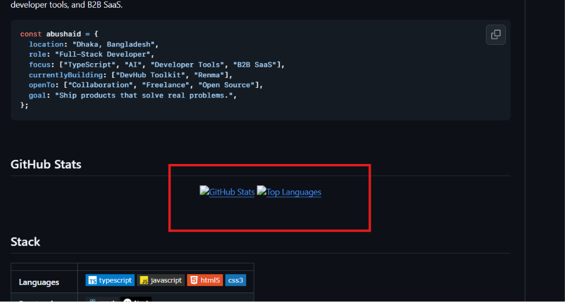

<p align="center">
  <a href="https://syed.flinkeo.online"><b>PORTFOLIO</b></a>
  &nbsp;·&nbsp;
  <a href="https://linkedin.com/in/abushaidislam"><b>LINKEDIN</b></a>
  &nbsp;·&nbsp;
  <a href="mailto:abushaidislam7@gmail.com"><b>EMAIL</b></a>
  &nbsp;·&nbsp;
  <a href="https://devhub.flinkeo.online"><b>DEVHUB</b></a>
</p>

<br />

## About

I build scalable web products from interface to infrastructure. My current focus is **TypeScript**, production-ready **AI integrations**, developer tools, and B2B SaaS.

```ts
const abushaid = {
  location: "Dhaka, Bangladesh",
  role: "Full-Stack Developer",
  focus: ["TypeScript", "AI", "Developer Tools", "B2B SaaS"],
  currentlyBuilding: ["DevHub Toolkit", "Renma"],
  openTo: ["Collaboration", "Freelance", "Open Source"],
  goal: "Ship products that solve real problems.",
};
